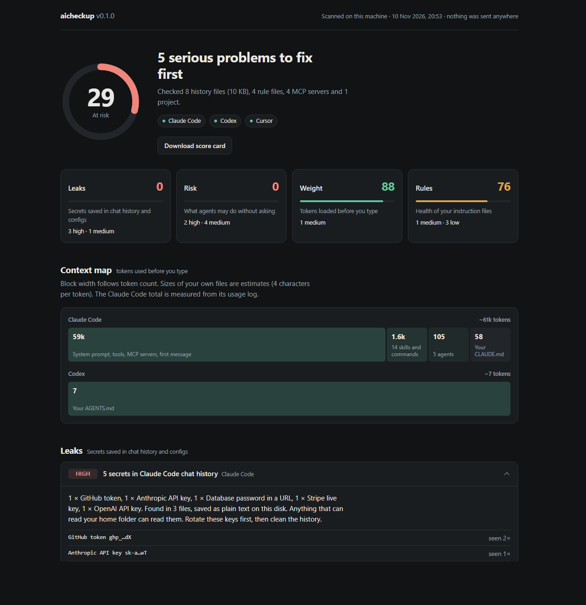

# agentcheckup

**A health check for your AI coding setup. One command, one score, runs only on your machine.**

```bash
npx agentcheckup
```

It scans the files that Claude Code, Codex and Cursor keep on your disk and opens a report with a score from 0 to 100.



The picture shows fake data from `npm run demo`.

## What it checks

| Section | Question it answers |
|---|---|
| **Leaks** | Are API keys, tokens or database passwords sitting in my AI chat history in plain text? |
| **Risk** | What may my agents do without asking me? Wide permission rules, no sandbox, hooks that reach the network, MCP servers that run unpinned packages. |
| **Weight** | How many tokens are loaded before I type a word, and what is using them? |
| **Rules** | Are my `CLAUDE.md`, `AGENTS.md` and Cursor rules healthy? Too long, repeated lines, broken imports, stale file paths, two files that disagree. |

Every finding says what is wrong, where it is, and how to fix it.

## Privacy

- Nothing leaves your machine. There are no network calls and no telemetry.
- There are zero dependencies. The whole tool is a few small files you can read.
- A secret is never printed or stored. The report shows the type and a masked preview such as `ghp_…dX`.
- The report server listens on `127.0.0.1` only and needs a one-time token.

## Cleaning leaked secrets

```bash
npx agentcheckup fix
```

This replaces each secret in your chat history files with `[REDACTED]`. The same action is behind the **Clean history** button in the report.

- Every file is backed up first in `~/.agentcheckup/backups`.
- Files written in the last 10 minutes are skipped, because a running session may still own them. Close your AI tools first.
- Databases (Cursor chat storage, Codex SQLite files) are reported but never edited.

```bash
npx agentcheckup undo
```

Restores the files from the last fix.

```bash
npx agentcheckup purge
```

Deletes the backups. Do this once your tools work fine, because the backups still hold the secrets.

**Cleaning a file does not make a leaked key safe. Rotate the key as well.**

## Options

| Option | What it does |
|---|---|
| `--json` | Print the result as JSON and exit. |
| `--html <file>` | Write the report to a file. |
| `--only claude,codex,cursor` | Scan only these tools. |
| `--fail-under <n>` | Exit with code 1 when the score is below `n`. Useful in CI. |
| `--no-open` | Do not open the browser. |
| `--home <dir>` | Scan another folder as the home folder. |

## How the score works

Each section starts at 100. A high finding costs 30 points, a medium one 12 and a low one 4. The total is a weighted average: Leaks 35%, Risk 30%, Weight 20%, Rules 15%.

The **Download score card** button makes an image with the five numbers only. It holds no paths, keys or names, so it is safe to share.

## Limits you should know

- Secret detection covers keys with a fixed format (Anthropic, OpenAI, GitHub, GitLab, AWS, Google, Slack, Stripe, npm, Hugging Face, SendGrid, Telegram, private key blocks, database URLs). A password written as a plain word is not detected.
- Token sizes of your own files are estimates (4 characters per token). The Claude Code session total is real: it is read from Claude Code's own usage log.
- A large history takes time. Expect about 10 seconds per gigabyte on a 4-core laptop.
- Compressed Codex sessions (`.zst`) need Node 22.15 or newer. On older versions they are skipped.
- The tests run on Windows, macOS and Linux in CI. A scan of a real machine has been checked on Windows only so far.

## Try it on fake data

```bash
npm run demo
```

This builds a deliberately unhealthy fake setup in a temp folder and opens its report. Use it for screenshots.

## Development

```bash
npm test
```

Needs Node 20 or newer. There is nothing to install.

Adding a tool means adding its folders in `src/sources.js`. Adding a secret type means adding one line to `PATTERNS` in `src/secrets.js` and its literal prefix to `CANDIDATE` below it.

## Licence

MIT
